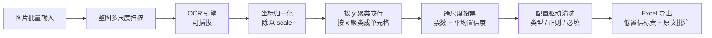

# screenshot-to-excel-ocr

把截图 / 扫描件里的表格数据，批量提取成结构化 Excel 报表。

输入一批图片，输出一份列顺序固定、低置信度自动标黄、可直接人工复核的 `.xlsx`。
OCR 引擎可插拔，核心流程不依赖任何模型文件，**所有设置都能在图形界面里完成，不需要命令行**。

---

## 图形界面（推荐）

```bash
python gui.py
```

Windows 下也可以创建一个内容为 `python gui.py` 的 `.bat` 双击启动。界面基于 Python 标准库
`tkinter`，无需任何额外 GUI 依赖。窗口分三个标签页：

| 标签页 | 可设置的项 |
| --- | --- |
| **运行** | 图片文件夹、输出 xlsx、演示模式、开始处理、检查环境、运行日志 |
| **识别参数** | OCR 引擎、扫描尺度、识别分数下限、自带 OCR 模块的**模块目录 / 模型目录**、行/列聚类容差、低置信阈值、去表情符号、全角转半角 |
| **列定义** | 列名、类型、正则校验、必填、绑定位置 `index`、列宽；支持新增 / 编辑 / 删除 / 上移 / 下移，行顺序即 Excel 列顺序 |

窗口底部是**配置文件栏**：浏览 / 加载 / 保存 / 另存为 / 恢复示例。所有设置会随配置一起保存，
下次启动自动加载 `config.json`。示例文件 `config.example.json` 受保护，保存时会自动要求另存为。

其他细节：

- 「检查环境」按钮会列出 Python、openpyxl、Pillow、tkinter、RapidOCR 后端是否可用，以及自带 OCR 模块的 `maa_ocr.py` 与 `det.onnx / rec.onnx / keys.txt` 是否齐全。
- 选了 `dummy` 引擎却没勾演示模式时，会弹窗提醒「当前只会输出合成数据，不会识别图片」，避免误把假数据当成识别结果。
- 使用 `maaocr` 引擎时，模块目录和模型目录在界面里填即可，程序会在进程内部完成设置，**不需要预先配置环境变量**。这两个路径属于本机设置，不要提交到仓库。
- 耗时任务在后台线程执行，结果通过队列回到主线程刷新日志，窗口不会卡死。

> 演示模式使用内置合成数据（`A-1024 / B-2078 / C-3310` 三行）。看到这三行重复出现，说明当前跑的是演示数据或 `dummy` 引擎，而不是你的图片识别结果。

## 命令行（可选）

```bash
pip install -r requirements.txt
python cli.py --demo                      # 零素材验证链路
python cli.py --input ./samples --output ./output/report.xlsx \
              --config config.example.json --engine rapidocr --scales 1,2,3
```

| 参数 | 说明 |
| --- | --- |
| `--input` | 图片文件夹，支持 png / jpg / jpeg / bmp / webp / tif |
| `--output` | 输出 xlsx 路径 |
| `--config` | 列定义与规则 |
| `--engine` | `dummy` / `rapidocr` / `maaocr` |
| `--scales` | 扫描尺度，如 `1,2,3` |
| `--demo` | 内置合成数据，不需要图片或 OCR 模型 |

可选后端安装：`pip install -r requirements-ocr.txt`（RapidOCR）。

## 特性

- **多尺度扫描 + 跨尺度投票**：整图按 1x / 2x / 3x 扫描，坐标归一化回原图后按行、按列聚类，同一单元格按「出现票数优先、其次平均置信度」投票，抑制单尺度误识别。
- **配置驱动且可视化**：列名、类型、正则、必填、列宽、引擎与全部识别参数都能在界面里编辑并保存。
- **复核友好**：低置信度或校验未通过的单元格标黄，鼠标悬停可看 OCR 原文；另附「运行说明」sheet 记录参数与统计。
- **可交付**：支持 PyInstaller 打包为免环境安装的可执行文件。

> 为什么不逐行裁剪小图再识别：不少检测型 OCR 会对短边低于固定阈值的输入做强制等比拉伸，一行 20px 高的文字条会被拉到严重变形，检测反而全挂。整图多尺度 + 坐标投票是更稳的做法。

## 处理流程



```
根目录：gui.py（图形界面）、cli.py（命令行）、config.example.json（示例配置）、tests/（测试）

src/
├── config_io.py    配置加载 / 保存 / 校验（独立于界面，可单测）
├── models.py       数据容器（OCRItem / Cell / FieldResult / RowRecord）
├── preprocess.py   图片载入、整图多尺度
├── ocr/            后端注册表与三种实现（懒加载）
├── cluster.py      坐标归一化、行列聚类、投票
├── extract.py      清洗、类型转换、字段映射、复核标记
├── excel.py        报表写出
└── pipeline.py     编排与运行统计
```

## 配置说明

`config.example.json`（图形界面里的「识别参数 / 列定义」与之逐项对应）：

| 键 | 含义 |
| --- | --- |
| `columns[].name` | 输出列名，决定 Excel 列顺序 |
| `columns[].type` | `str` / `int` / `float` / `date` |
| `columns[].pattern` | 正则校验；不匹配则标黄并把置信度减半 |
| `columns[].required` | 缺失时强制标黄 |
| `columns[].index` | 可选，绑定到第几个聚类单元格；不填则按列顺序从左到右消费 |
| `columns[].width` | 可选，Excel 列宽 |
| `ocr.engine` / `ocr.scales` / `ocr.min_score` | 引擎、扫描尺度、识别分数下限 |
| `ocr.module_dir` / `ocr.model_dir` | 仅 `maaocr` 用，本机路径；示例中为空，不要提交真实路径 |
| `row_tolerance_ratio` | 行聚类容差 = 相邻框垂直间距中位数 × 该系数 |
| `col_tolerance_ratio` | 列聚类容差 = 单元格框宽中位数 × 该系数 |
| `low_confidence_threshold` | 低于此置信度标黄 |
| `strip_emoji` / `normalize_fullwidth` | 文本清洗开关 |

本地配置存成 `config.json`（已在 `.gitignore` 中），不要提交含路径或凭据的配置。

## 接入自己的 OCR 模块

`maaocr` 后端只约定接口，不绑定任何具体目录：在图形界面「识别参数」页填好模块目录与模型目录即可。
模块需暴露 `MaaOCR(model_dir=...)`，其 `recognize(image)` 返回 `(text, box, score)` 元组；
传入的是 `PIL.Image` 对象而不是路径字符串。`src/ocr/base.py` 的 `parse_raw()` 兼容
`(text, box, score)`、`(box, text, score)` 和字典三种格式，新增后端只需实现 `recognize()`。

## 测试

```bash
python -m unittest discover -s tests -v
```

测试只依赖核心依赖，覆盖坐标归一化、多尺度投票纠错、文本清洗、类型转换、配置往返与校验、
Excel 写出和端到端 demo，不需要图片素材或 OCR 模型。

## 打包为可执行文件（可选）

```bash
pip install pyinstaller
pyinstaller --onefile --name screenshot-to-excel gui.py
```

交付给非技术使用者时，建议同时附上示例配置、一份「使用前必读」和一张运行截图。

## 合规说明

- 仓库内不含任何第三方图片、模型权重、账号或凭据；演示模式使用合成数据。
- 使用者需自行确认输入数据来源合法、且遵守数据来源方的相关条款。
- 识别结果仅供辅助整理，低置信度条目应以人工复核为准。

## License

[MIT](LICENSE)
