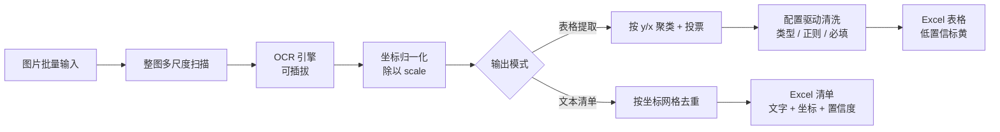

# screenshot-to-excel-ocr

把截图里的文字提取成 Excel，支持两种输出模式：

- **表格提取**：适用于规整的行列表格，按你定义的列输出，低置信度自动标黄。
- **文本清单**：适用于应用界面截图这类**没有表格**的画面，输出每条识别文字及其在原图中的坐标，可直接用于 UI 元素定位。

OCR 引擎可插拔，核心流程不依赖任何模型文件，**所有设置都能在图形界面里完成，不需要命令行**。

---

## 图形界面（推荐）

```bash
python gui.py
```

Windows 下也可以创建一个内容为 `python gui.py` 的 `.bat` 双击启动。界面基于
**customtkinter 5.2**（已列在 `requirements.txt`），采用浅色卡片风格：
`#f5f7fa` 灰蓝底、白色圆角卡片、`#3b82f6` 蓝主色、白色顶栏 + 蓝色图标块、彩色分级日志。

布局：

| 区域 | 内容 |
| --- | --- |
| **顶栏** | 蓝色图标块 + 标题 / 副标题、右侧「检查环境」和状态徽标 |
| **左列** | 「运行设置」卡片：图片文件夹、输出 xlsx、输出模式、去重网格、演示模式、主按钮；下方「当前状态」卡片显示引擎 / 模式 / 列数 |
| **右列** | 标签页「识别参数」（引擎、尺度、分数下限、模块/模型目录、聚类容差、低置信阈值、文本清洗）与「列定义」（增删改、上下移动）；下方常驻「运行日志」卡片 |
| **底栏** | 配置文件路径 + 浏览 / 加载 / 保存 / 另存为 / 恢复示例；最底部状态栏 |

其它细节：

- 日志按类型着色：配置（蓝）、数据（紫）、警告（橙）、成功（绿）、失败（红）、说明（灰），可一键清空。
- 「检查环境」列出 Python、openpyxl、Pillow、customtkinter、RapidOCR 后端是否可用，以及自带 OCR 模块的 `maa_ocr.py` 与 `det.onnx / rec.onnx / keys.txt` 是否齐全。
- 选了 `dummy` 引擎却没勾演示模式时，会弹窗提醒「当前只会输出合成数据」，避免误把假数据当成识别结果。
- 使用 `maaocr` 引擎时，模块目录和模型目录在界面里填即可，程序内部完成设置，**不需要预先配置环境变量**。这两个路径属于本机设置，不要提交到仓库。
- 耗时任务在后台线程执行，结果通过队列回到主线程刷新日志和状态，窗口不会卡死。

> 演示模式使用内置合成数据（`A-1024 / B-2078 / C-3310` 三行）。看到这三行重复出现，说明当前跑的是演示数据或 `dummy` 引擎，而不是你的图片识别结果。

## 两种输出模式

**表格提取**假设截图里有一张行列表格：整图多尺度扫描 → 坐标归一化 → 按 y 聚类成行、按 x 聚类成单元格 → 跨尺度投票 → 按 `columns` 定义清洗与校验 → 写出 `.xlsx`。如果截图是应用界面、按钮和标题散落各处，这个模式会把文字聚成「伪行」，结果不可用，应改选文本清单。

**文本清单**不做列映射，直接报告每个识别框：

| 列 | 含义 |
| --- | --- |
| `来源文件` | 来自哪张截图 |
| `序号` | 按文件 → y → x（从上到下、从左到右）排序后的序号 |
| `识别文本` | OCR 结果 |
| `置信度` | 识别分数，低于「低置信阈值」时标黄 |
| `中心X` / `中心Y` | 文本框中心点，已归一化回原图尺寸 |
| `尺度` | 该结果来自哪个扫描尺度 |

多尺度产生的重复框按 `(文件, 文本, 网格化坐标)` 合并，只保留分数最高的一条；网格大小由「去重网格(px)」控制，默认 12。
这个模式不要求定义列，适合做 UI 自动化里的文字定位与断言。

## 命令行（可选）

```bash
pip install -r requirements.txt
python cli.py --demo
python cli.py --input ./samples --output ./output/report.xlsx \
              --config config.example.json --engine rapidocr --scales 1,2,3
python cli.py --input ./samples --output ./output/text_dump.xlsx --mode text_dump
```

| 参数 | 说明 |
| --- | --- |
| `--input` | 图片文件夹，支持 png / jpg / jpeg / bmp / webp / tif |
| `--output` | 输出 xlsx 路径 |
| `--config` | 列定义与全部规则 |
| `--engine` | `dummy` / `rapidocr` / `maaocr` |
| `--mode` | `table`（表格提取）/ `text_dump`（文本清单），覆盖配置里的值 |
| `--scales` | 扫描尺度，如 `1,2,3` |
| `--demo` | 内置合成数据，不需要图片或 OCR 模型 |

可选后端安装：`pip install -r requirements-ocr.txt`（RapidOCR）。

## 特性

- **多尺度扫描 + 跨尺度投票**：整图按 1x / 2x / 3x 扫描，坐标归一化回原图后按行、按列聚类，同一单元格按「出现票数优先、其次平均置信度」投票，抑制单尺度误识别。
- **双输出模式**：规整表格走结构化列，非表格界面走文字 + 坐标清单。
- **浅色卡片 UI**：customtkinter 分栏布局、圆角卡片、彩色分级日志、状态徽标。
- **配置驱动且可视化**：列名、类型、正则、必填、列宽、输出模式、引擎与全部识别参数都能在界面里编辑并保存。
- **复核友好**：低置信度结果标黄；表格模式鼠标悬停可看 OCR 原文；两份输出都附「运行说明」sheet 记录参数与统计。
- **可交付**：支持 PyInstaller 打包为免环境安装的可执行文件。

> 为什么不逐行裁剪小图再识别：不少检测型 OCR 会对短边低于固定阈值的输入做强制等比拉伸，一行 20px 高的文字条会被拉到严重变形，检测反而全挂。整图多尺度 + 坐标投票是更稳的做法。

## 处理流程



```
根目录：gui.py（图形界面）、cli.py（命令行）、config.example.json（示例配置）、tests/（测试）

src/
├── config_io.py    配置加载 / 保存 / 校验（独立于界面，可单测）
├── dump.py         文本清单模式：收集、去重、写出
├── models.py       数据容器（OCRItem / Cell / FieldResult / RowRecord）
├── preprocess.py   图片载入、整图多尺度
├── ocr/            后端注册表与三种实现（懒加载）
├── cluster.py      坐标归一化、行列聚类、投票（表格模式）
├── extract.py      清洗、类型转换、字段映射、复核标记（表格模式）
├── excel.py        表格模式报表写出
└── pipeline.py     编排与运行统计
```

## 配置说明

`config.example.json`（图形界面里的设置与之逐项对应）：

| 键 | 含义 |
| --- | --- |
| `columns[].name` | 输出列名，决定 Excel 列顺序（表格提取模式） |
| `columns[].type` | `str` / `int` / `float` / `date` |
| `columns[].pattern` | 正则校验；不匹配则标黄并把置信度减半 |
| `columns[].required` | 缺失时强制标黄 |
| `columns[].index` | 可选，绑定到第几个聚类单元格；不填则按列顺序从左到右消费 |
| `columns[].width` | 可选，Excel 列宽 |
| `output.mode` | `table`（表格提取）/ `text_dump`（文本清单） |
| `dump.dedup_grid` | 文本清单去重网格，单位像素，默认 12 |
| `ocr.engine` / `ocr.scales` / `ocr.min_score` | 引擎、扫描尺度、识别分数下限 |
| `ocr.module_dir` / `ocr.model_dir` | 仅 `maaocr` 用，本机路径；示例中为空，不要提交真实路径 |
| `row_tolerance_ratio` | 行聚类容差 = 相邻框垂直间距中位数 × 该系数 |
| `col_tolerance_ratio` | 列聚类容差 = 单元格框宽中位数 × 该系数 |
| `low_confidence_threshold` | 低于此置信度标黄 |
| `strip_emoji` / `normalize_fullwidth` | 文本清洗开关 |

本地配置存成 `config.json`（已在 `.gitignore` 中），不要提交含路径或凭据的配置。

## 接入自己的 OCR 模块

`maaocr` 后端只约定接口，不绑定任何具体目录：在图形界面「识别参数」页填好模块目录与模型目录即可。
模块需暴露 `MaaOCR(model_dir=...)`，其 `recognize(image)` 返回 `(text, box, score)` 元组；
传入的是 `PIL.Image` 对象而不是路径字符串。`src/ocr/base.py` 的 `parse_raw()` 兼容
`(text, box, score)`、`(box, text, score)` 和字典三种格式，新增后端只需实现 `recognize()`。

## 测试

```bash
python -m unittest discover -s tests -v
```

测试只依赖核心依赖，覆盖坐标归一化、多尺度投票纠错、文本清洗、类型转换、配置往返与校验、
双输出模式的 Excel 写出和端到端 demo，不需要图片素材或 OCR 模型。

## 打包为可执行文件（可选）

```bash
pip install pyinstaller
pyinstaller --onefile --name screenshot-to-excel gui.py
```

交付给非技术使用者时，建议同时附上示例配置、一份「使用前必读」和一张运行截图。

## 合规说明

- 仓库内不含任何第三方图片、模型权重、账号或凭据；演示模式使用合成数据。
- 使用者需自行确认输入数据来源合法、且遵守数据来源方的相关条款。
- 识别结果仅供辅助整理，低置信度条目应以人工复核为准。

## License

[MIT](LICENSE)
